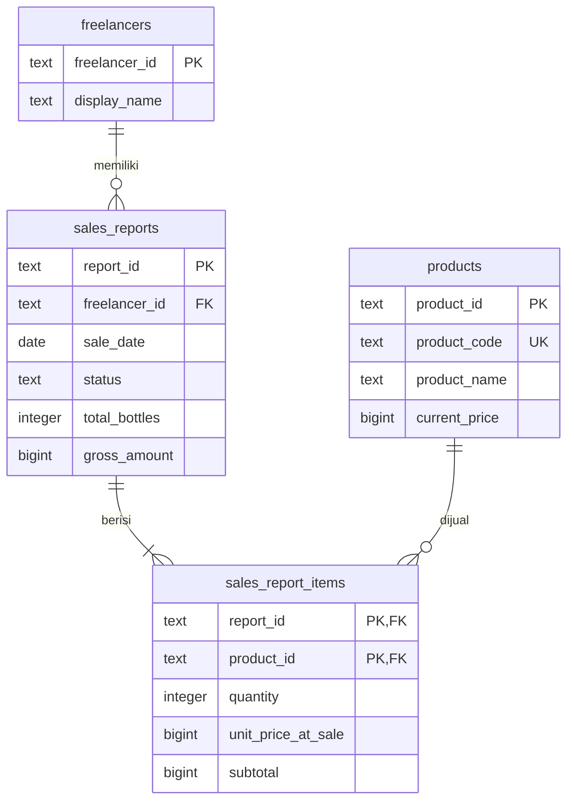

# Pemetaan dataset Arloraka Coffee ke database

Paket ini memetakan 18 kolom dataset awal ke empat tabel PostgreSQL. Data sumber berisi 750 laporan simulasi dari 1 Juli sampai 20 Oktober 2026. Setiap baris sumber menjadi satu laporan; setiap produk dengan kuantitas positif menjadi satu rincian laporan.

Rancangan ini disiapkan sebagai acuan implementasi DS-1 dan backend. Struktur backend belum tersedia di folder proyek saat paket dibuat. Nama tabel, kolom, dan ID produk di sini sudah konkret dan dapat dipakai tim, tetapi belum ada bukti peninjauan atau persetujuan anggota tim terhadap skema ini.

## Berkas yang digunakan

| Berkas | Kegunaan |
|---|---|
| `schema.sql` | Membuat schema `arloraka`, empat tabel, relasi, aturan validasi, dan view kontribusi approved |
| `seed.sql` | Mengisi seluruh data awal dalam satu transaksi; dapat dijalankan ulang |
| `verify.sql` | Memeriksa jumlah data, rekap status, rekonsiliasi rincian, serta kontribusi bulanan/freelancer |
| `column_mapping.csv` | Tabel pemetaan seluruh 18 kolom sumber |
| `seed/freelancers.csv` | 10 freelancer dummy, satu baris per ID |
| `seed/products.csv` | 6 produk dan harga awal dari generator |
| `seed/sales_reports.csv` | 750 laporan dan status aplikasi |
| `seed/sales_report_items.csv` | 1.681 rincian produk berkuantitas positif |
| `prepare_seed.py` | Membentuk ulang data awal dari CSV dan harga pada notebook generator |
| `validation_report.json` | Angka kontrol, asal harga, dan sidik berkas sumber |
| `tests/run-tests.mjs` | Menjalankan 12 skenario uji dengan data awal yang direset setiap skenario |
| `package.json` dan `package-lock.json` | Perintah tes dan versi dependensi yang dikunci |
| `test_results.json` | Hasil eksekusi `npm --prefix database run test:report` |

## Hubungan tabel



PK adalah identitas unik record, FK menghubungkan record ke tabel lain, dan UK berarti nilai harus unik. Rincian memakai gabungan `(report_id, product_id)` sebagai identitas: satu produk muncul sekali pada satu laporan, dengan kuantitas yang sudah dijumlahkan.

## Tabel pemetaan kolom sumber

Semua tabel berikut berada pada schema `arloraka`.

| Kolom sumber | Tujuan | Transformasi dan aturan |
|---|---|---|
| `transaction_id` | `sales_reports.report_id` dan `source_transaction_id` | Salin ID, misalnya `TRX-0161`. ID tetap ketika laporan direvisi. `source_dataset` diisi `dummy_sales_arloraka_coffee_750` |
| `tanggal_jual` | `sales_reports.sale_date` | Ubah menjadi DATE; bulan komisi mengikuti tanggal ini |
| `freelancer_id` | `freelancers.freelancer_id` dan `sales_reports.freelancer_id` | Bentuk satu master per ID, lalu hubungkan laporan menggunakan ID tersebut |
| `nama_freelancer` | `freelancers.display_name` | Nama yang sama tidak menyatukan dua ID berbeda; satu ID tidak boleh memiliki nama sumber yang bertentangan |
| `americano_qty` | `sales_report_items` | `PRD-001`, kuantitas dari kolom ini, harga transaksi Rp10.000; abaikan rincian jika qty = 0 |
| `latte_qty` | `sales_report_items` | `PRD-002`, harga transaksi Rp13.000; rincian hanya jika qty > 0 |
| `aren_latte_qty` | `sales_report_items` | `PRD-003`, harga transaksi Rp16.000; rincian hanya jika qty > 0 |
| `matcha_latte_qty` | `sales_report_items` | `PRD-004`, harga transaksi Rp16.000; rincian hanya jika qty > 0 |
| `redvelvet_latte_qty` | `sales_report_items` | `PRD-005`, harga transaksi Rp14.000; rincian hanya jika qty > 0 |
| `mocha_latte_qty` | `sales_report_items` | `PRD-006`, harga transaksi Rp14.000; rincian hanya jika qty > 0 |
| `total_botol` | `sales_reports.total_bottles` | Harus sama dengan jumlah `quantity` rincian laporan |
| `omzet_penjualan` | `sales_reports.gross_amount` | Harus sama dengan jumlah `quantity × unit_price_at_sale` |
| `komisi_freelancer` | Pembanding `sales_reports.commission_amount` | Nilai sumber diperiksa. Database menghitung ulang komisi 10% dengan pembulatan ke atas per laporan |
| `pendapatan_manajemen` | Pembanding `sales_reports.management_amount` | Nilai sumber diperiksa. Database menghitung omzet dikurangi komisi; biaya usaha belum dikurangi |
| `metode_pembayaran` | `sales_reports.payment_method` | Salin Cash, QRIS, atau Transfer; ini pembayaran penjualan, bukan pembayaran komisi |
| `lokasi_penjualan` | `sales_reports.sale_location` | Salin kategori lokasi. Loader memeriksa enam kategori seed; database menerima teks berisi untuk kebutuhan lokasi berikutnya |
| `status_verifikasi` | `sales_reports.status` | Verified → approved; Pending → pending; Rejected → rejected |
| `keterangan` | `sales_reports.notes` | Salin catatan. Tanda `-` atau teks kosong diubah menjadi NULL karena berarti tidak ada catatan khusus |

Kolom `commission_amount`, `management_amount`, dan `sales_report_items.subtotal` dihitung database. Berkas seed tidak mengirim nilai ke kolom tersebut. Perilaku ini memakai [stored generated columns PostgreSQL](https://www.postgresql.org/docs/current/ddl-generated-columns.html).

## Pemetaan produk dan harga transaksi

| ID produk | Kode produk | Nama | Harga awal |
|---|---|---|---:|
| PRD-001 | americano | Americano | Rp10.000 |
| PRD-002 | latte | Latte | Rp13.000 |
| PRD-003 | aren_latte | Aren Latte | Rp16.000 |
| PRD-004 | matcha_latte | Matcha Latte | Rp16.000 |
| PRD-005 | redvelvet_latte | Redvelvet Latte | Rp14.000 |
| PRD-006 | mocha_latte | Mocha Latte | Rp14.000 |

`prepare_seed.py` membaca literal `MENU_PRICES` dari `DataDummyCafe.ipynb` tanpa menjalankan generator. Sumber dataset tidak memiliki riwayat perubahan harga; harga transaksi lama direkonstruksi dengan asumsi harga generator tetap pada periode simulasi tersebut.

`products.current_price` adalah harga master untuk transaksi baru. `sales_report_items.unit_price_at_sale` menyimpan salinan harga transaksi; `product_name_at_sale` menyimpan nama pada saat itu. Subtotal dan omzet laporan lama memakai salinan tersebut. Mengubah master produk tidak menjalankan pembaruan ke rincian laporan lama.

Backend mengambil harga dari master yang dikelola manajemen saat membuat laporan baru. Freelancer mengirim produk dan kuantitas; backend perlu memeriksa kuantitas sebelum konversi ke INTEGER, memeriksa produk aktif, dan menyimpan harga transaksi yang dipilih sistem. Harga lama hanya berubah melalui koreksi resmi terhadap laporan terkait.

## Contoh satu laporan

`TRX-0161` dimiliki `FL-010` (Jihan) dengan tanggal penjualan 1 Juli 2026 dan status approved.

| report_id | product_id | quantity | unit_price_at_sale | subtotal |
|---|---|---:|---:|---:|
| TRX-0161 | PRD-003 | 2 | Rp16.000 | Rp32.000 |
| TRX-0161 | PRD-006 | 1 | Rp14.000 | Rp14.000 |

Header laporan menyimpan 3 botol dan omzet Rp46.000. Komisi nominalnya Rp4.600 dan bagian manajemen Rp41.400. Jika harga Aren Latte pada master menjadi Rp17.000, rincian laporan ini tetap memakai Rp16.000.

## Status, kontribusi, dan komisi

| Status sumber | Status database | Masuk kontribusi? |
|---|---|---|
| Verified | approved | Ya |
| Pending | pending | Tidak |
| Rejected | rejected | Tidak |
| Belum tersedia pada seed | revision | Tidak |

View `arloraka.approved_reports` menyediakan dasar kontribusi yang sudah difilter. Riwayat tetap mengambil seluruh status dari `sales_reports`. Persetujuan berulang memperbarui status pada laporan yang sama dan tidak membuat record baru.

`commission_amount` menyimpan nominal aturan per laporan untuk semua status. Nilai pada laporan pending/revision/rejected tidak otomatis menjadi komisi yang diakui. Laporan approved pada bulan berjalan menghasilkan estimasi; pengakuan akhir bulan memakai bulan `sale_date`, lalu menjumlahkan komisi per laporan tanpa pembulatan ulang. Dataset hanya menyimpan status terkini dan tidak membuktikan waktu keputusan, pengakuan aktual, atau pembayaran.

`management_amount` adalah bagian omzet setelah komisi, dengan pembulatan sebagai penyesuaian. Angka ini belum menjadi laba usaha. Semua transaksi seed diberi `is_dummy = true`; aplikasi perlu mempertahankan label simulasi. Untuk transaksi nyata, backend harus mengisi penanda tersebut secara eksplisit sesuai sumbernya.

## Import awal dan import ulang

Urutan pengisian adalah freelancer → produk → laporan → rincian produk. `seed.sql` menjalankan seluruh tahap dalam satu transaksi. Commit dilakukan setelah total header dan rincian cocok. Rincian positif wajib tersedia untuk setiap laporan; import CSV per tabel dengan commit terpisah akan gagal ketika laporan belum memiliki rincian.

Seed menggunakan [ON CONFLICT dan RETURNING PostgreSQL](https://www.postgresql.org/docs/current/sql-insert.html). Jika pasangan `(source_dataset, source_transaction_id)` sudah ada, laporan dilewati. Rincian hanya diisi untuk laporan yang benar-benar baru pada eksekusi itu. Perubahan harga master, status, dan koreksi yang sudah tersimpan tidak ditimpa ketika seed dijalankan lagi. ID laporan yang ternyata milik sumber berbeda ditolak agar tidak tertukar.

Perilaku ini mengisi seed baru dan melewati laporan lama secara utuh. Jika laporan lama rusak atau perlu diperbaiki, gunakan jalur koreksi resmi; menjalankan seed ulang tidak memulihkannya dari CSV secara otomatis.

Pada PowerShell, jalankan dari root proyek dengan koneksi database pengembangan milik tim:

```powershell
if (-not $env:ARLORAKA_DATABASE_URL) { throw 'Isi ARLORAKA_DATABASE_URL untuk database pengembangan yang dituju.' }
psql --dbname "$env:ARLORAKA_DATABASE_URL" --set ON_ERROR_STOP=on --file database/schema.sql
psql --dbname "$env:ARLORAKA_DATABASE_URL" --set ON_ERROR_STOP=on --file database/seed.sql
psql --dbname "$env:ARLORAKA_DATABASE_URL" --set ON_ERROR_STOP=on --file database/verify.sql
```

Untuk membentuk ulang CSV dan SQL seed dari sumber proyek:

```powershell
python database/prepare_seed.py
```

Perintah tersebut hanya memperbarui berkas turunan pada folder `database`; dataset asli dan notebook generator tetap menjadi sumber. `schema.sql` adalah skema awal yang dapat dijalankan ulang pada struktur yang sama. Jika tim sudah mempunyai struktur berbeda, sesuaikan melalui migrasi yang ditinjau sebelum menggabungkannya.

## Koreksi dan validasi backend

Pembuatan atau koreksi laporan harus menyimpan header dan rincian dalam satu transaksi. Pada koreksi, backend mengunci header dengan `SELECT ... FOR UPDATE`, mengubah rincian yang disahkan, menghitung ulang total dari rincian, dan menaikkan `version`. Simpan alasan, pelaku, waktu, serta nilai sebelum/sesudah pada riwayat koreksi aplikasi. Empat tabel inti paket ini belum memuat tabel riwayat tersebut.

Skema memakai [constraint trigger yang ditunda sampai akhir transaksi](https://www.postgresql.org/docs/current/sql-createtrigger.html) untuk menolak selisih antara header dan rincian. Backend tetap perlu mengunci header sebelum memodifikasi laporan dan menguji penggunaan bersamaan pada server tujuan. Generated columns akan menghitung ulang nominal komisi dan sisa manajemen ketika omzet berubah. UI memperbarui data melalui mekanisme backend; view database sendiri tidak mengirim pembaruan realtime ke browser.

Master freelancer atau produk dinonaktifkan melalui `is_active`, dengan histori tetap tersimpan. Relasi mencegah penghapusan master yang masih dipakai laporan. Pengaturan aktif pada seed adalah nilai awal demo, bukan bukti keadaan operasional UMKM.

## Angka kontrol dan pengujian

| Kontrol seed awal | Hasil |
|---|---:|
| Freelancer | 10 |
| Produk | 6 |
| Laporan | 750 |
| Rincian produk | 1.681 |
| Total seluruh botol | 2.145 |
| Omzet seluruh laporan | Rp30.019.000 |
| Laporan approved | 693 |
| Laporan pending | 42 |
| Laporan rejected | 15 |
| Botol approved | 1.986 |
| Omzet approved | Rp27.776.000 |
| Jumlah nominal komisi approved | Rp2.777.600 |
| Bagian manajemen approved | Rp24.998.400 |

Skema dan seed telah dijalankan pada PostgreSQL 17.5 melalui PGlite di memori. Pengujian meliputi import ulang, harga/nama master yang berubah, koreksi laporan, status, rincian ganda, produk tanpa master, total yang tidak cocok, dan pembulatan komisi. Rincian hasil tersedia pada `test_results.json`. Pengujian tersebut tidak terhubung ke database aplikasi pengguna.

Skrip pengujian sekarang tersedia di repository. Dari root proyek, jalankan `npm --prefix database ci`, lalu `npm --prefix database test`. Gunakan `npm --prefix database run test:report` untuk memperbarui laporan JSON. Lihat [petunjuk pengujian](tests/README.md) untuk rincian kasus dan pembacaan hasil.

Angka di atas berlaku untuk seed awal. Koreksi yang sah dapat mengubah nominal dan kontribusi; hasil rekonsiliasi header-rincian harus tetap tanpa selisih. Backend, pembatasan akses pengguna, pembayaran, dan penggunaan bersamaan pada server belum termasuk pengujian paket ini.

## Pekerjaan integrasi tim

Kevin dapat memakai schema dan seed ini sebagai dasar penyimpanan laporan. Jika backend menggunakan UUID, pertahankan pasangan asal `source_dataset` dan `source_transaction_id` saat memetakan ke ID internal. Nama kolom pada API dapat berbeda selama pemetaan ke tabel tetap jelas.

Modul akun, relasi akun-freelancer, file bukti, keputusan verifikasi, riwayat koreksi, target, pengakuan komisi, dan pembayaran membutuhkan tabel pendukung sesuai Overview. Jangan mengisi waktu persetujuan atau pembayaran dari `sale_date` atau `created_at`: `sale_date` adalah tanggal penjualan, sedangkan `created_at` pada seed merupakan waktu import.

Langkah integrasi berikutnya adalah menjalankan schema dan seed pada database pengembangan tim, memeriksa hasil `verify.sql`, lalu menghubungkan formulir dan dashboard ke tabel/view yang sesuai.
